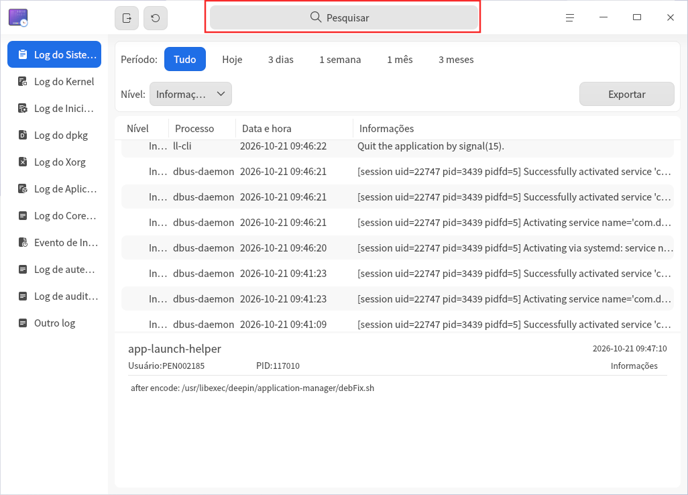
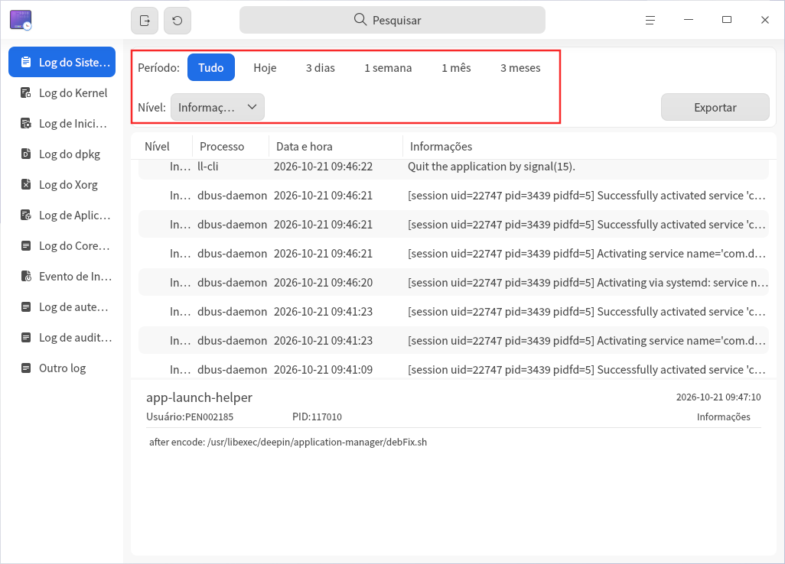
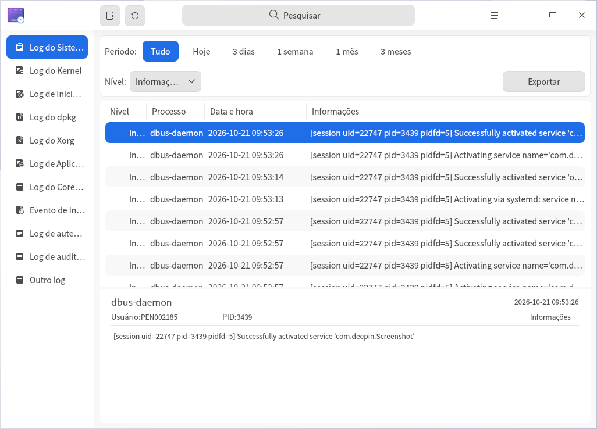
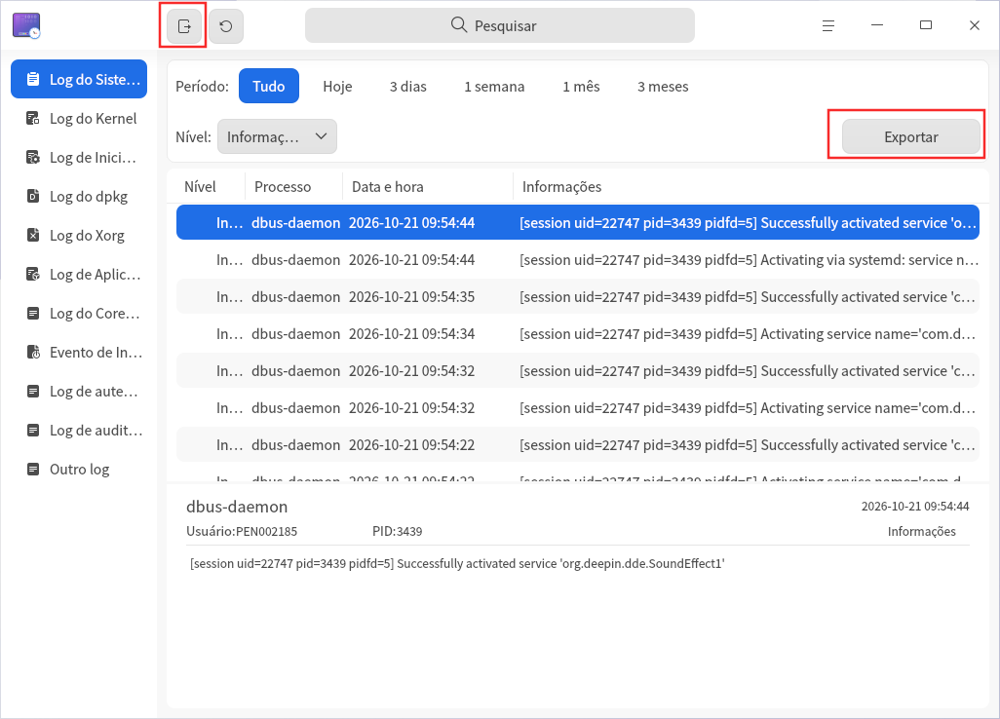
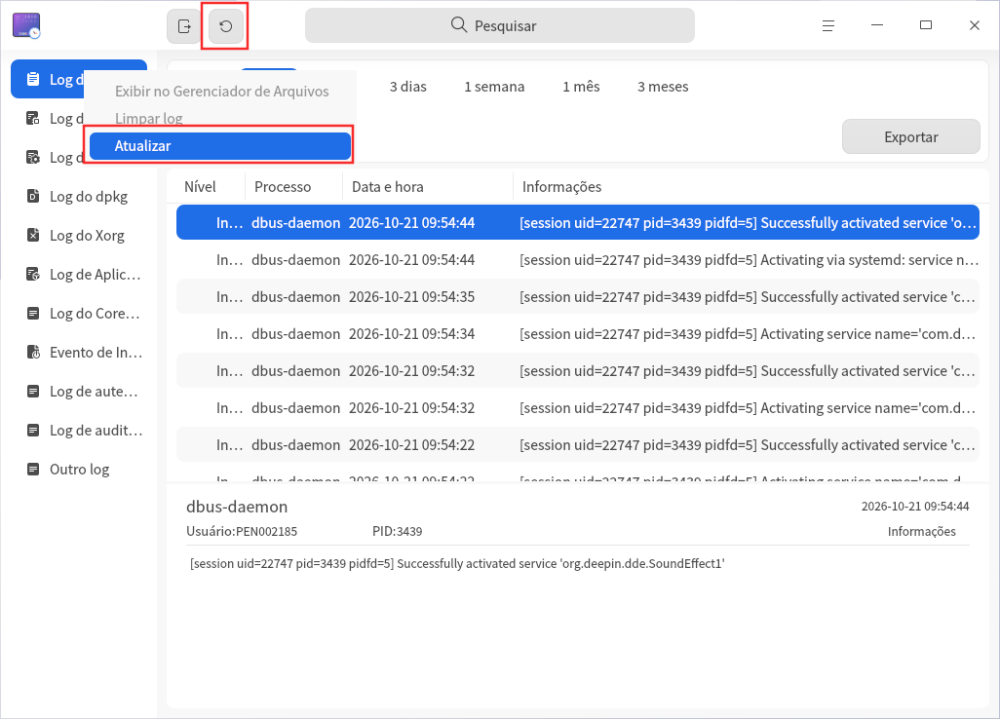
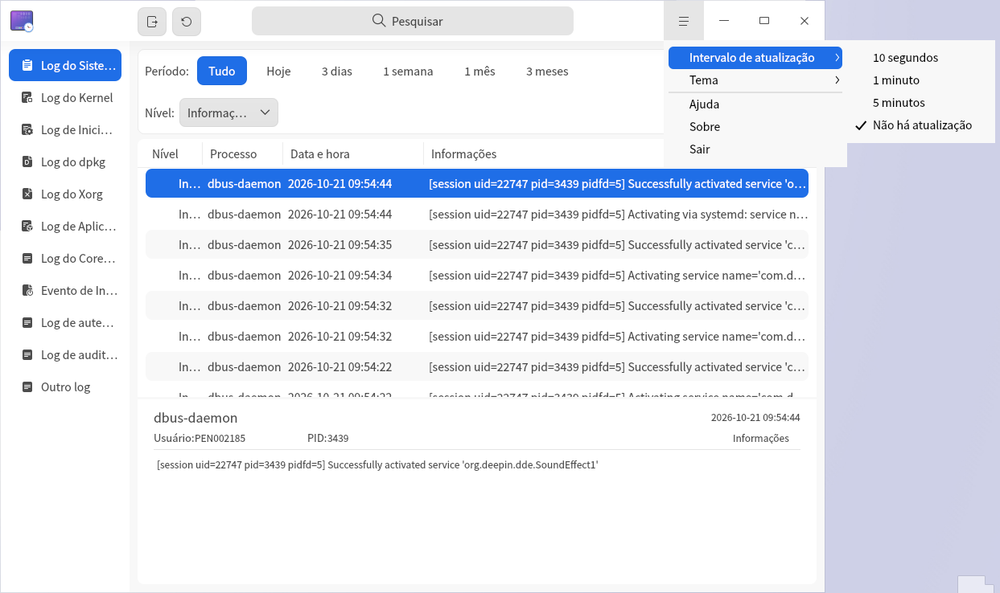
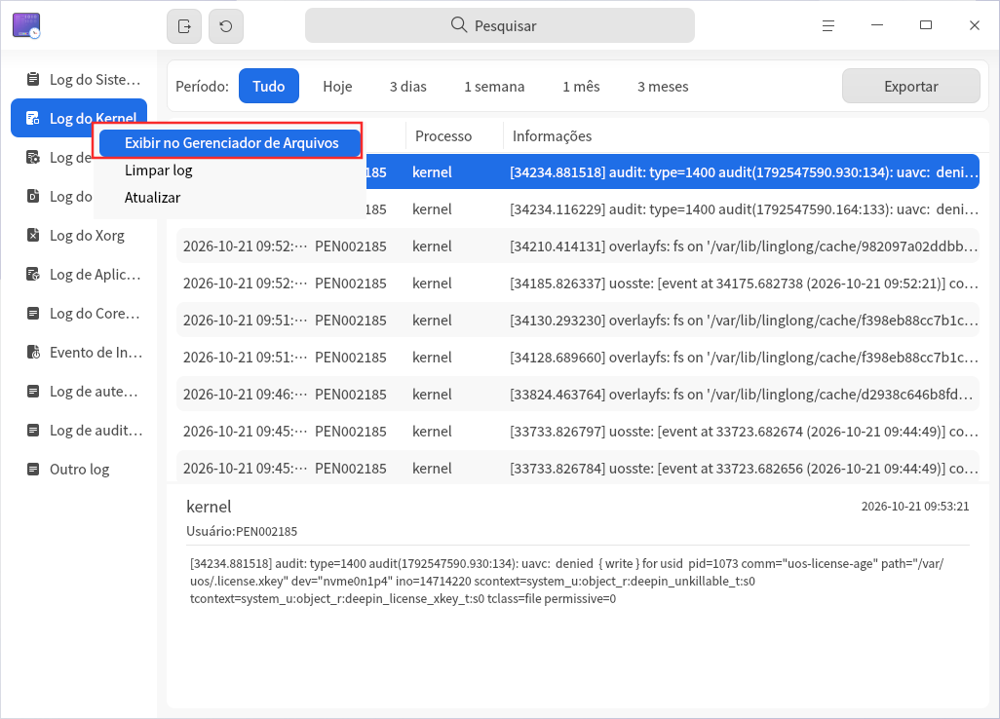
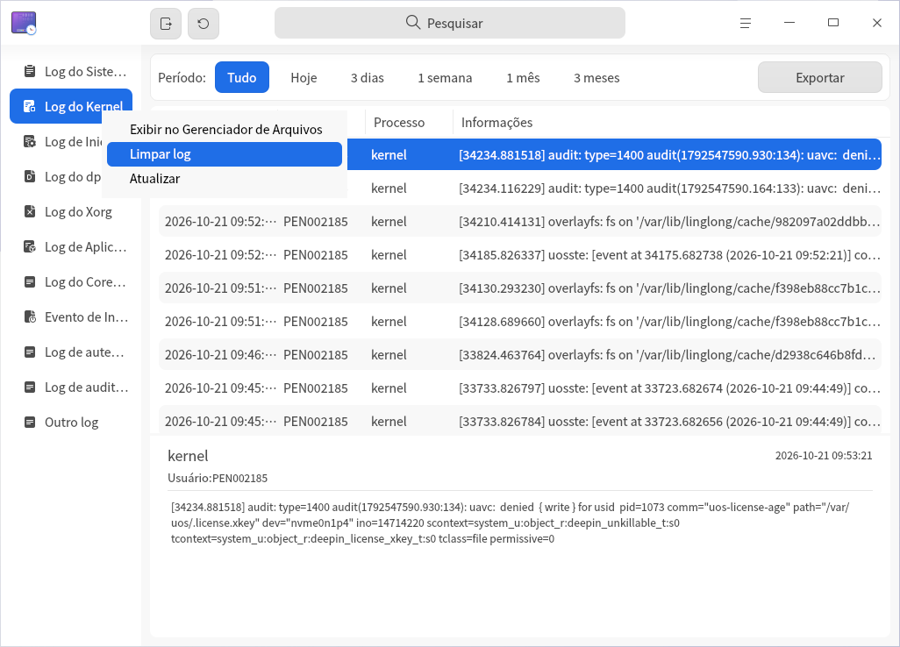

# Visualizador de Logs|deepin-log-viewer|

## Visão Geral

O Visualizador de Logs é um utilitário responsável por coletar os logs gerados durante a execução de programas, como as informações relacionadas ao processo de inicialização e execução do sistema operacional e dos aplicativos. Ao analisar as informações detalhadas dos logs, você pode identificar rapidamente a causa de falhas e resolver problemas.

## Introdução ao Uso

Você pode iniciar, sair do Visualizador de Logs ou criar atalhos usando as seguintes etapas.

### Iniciar o Visualizador de Logs

1. Clique no ícone do launcher na barra de tarefas , para acessar a interface do launcher.
2. Role a roda de scroll do mouse para navegar ou use a função de busca para encontrar o ícone do Visualizador de Logs , e clique para iniciá-lo.
3. Clique com o botão direito no ícone , você pode executar as seguintes operações:
   - Clicar em **Enviar para a Mesa de Trabalho**, para criar um atalho na mesa de trabalho.
   - Clicar em **Enviar para a Barra de Tarefas**, para fixar o aplicativo na barra de tarefas.
   - Clicar em **Iniciar com o Sistema**, para adicionar o aplicativo à lista de inicialização, fazendo com que ele inicie automaticamente ao ligar o computador.

### Sair do Visualizador de Logs

- Na interface principal do Visualizador de Logs, clique em  para sair.
- Clique com o botão direito no ícone  na barra de tarefas e selecione **Fechar Todos** para sair.
- Na interface principal do Visualizador de Logs, clique em  e selecione **Sair** para sair.

## Introdução às Operações

>  O Visualizador de Logs suporta a exibição de diversos tipos de logs. Devido às diferenças entre versões ou arquiteturas do sistema, os tipos de logs disponíveis podem variar; as funções específicas devem ser consideradas conforme o conteúdo exibido na página final.
>
>  Devido às diferenças entre os tipos de logs, as opções de filtro fornecidas, a possibilidade de exibição no Gerenciador de Arquivos e o suporte à limpeza de logs também podem variar; as funções específicas devem ser consideradas conforme o conteúdo exibido na página final.
>
> A seguir, os logs do sistema e os logs do kernel serão usados como exemplo para apresentar os métodos de operação do Visualizador de Logs.

### Buscar Logs

1. Na caixa de busca do Visualizador de Logs, clique em .
2. Digite a palavra-chave e os resultados da busca serão exibidos em tempo real.
3. Clique em  para limpar o conteúdo da caixa de busca.
   

### Filtrar Logs

1. Na barra de filtro no topo do Visualizador de Logs, selecione as opções de filtro desejadas.
2. Após clicar ou selecionar as opções de filtro, o Visualizador de Logs exibirá imediatamente os resultados filtrados.
   

### Visualizar Logs

1. Na interface principal do Visualizador de Logs, clique no menu do tipo de log que deseja visualizar; a lista à direita exibirá todas as entradas de log do tipo atual.
2. Clique com o botão esquerdo do mouse em uma entrada de log para visualizar as informações detalhadas desse log na parte inferior da ferramenta.
   

### Logs Personalizados

O recurso de logs personalizados permite adicionar arquivos de log ao Visualizador de Logs para visualização e exportação. Os logs personalizados suportam a configuração via Gsettings e a configuração via Dconfig.

**Configuração Gsettings**

1. No terminal, execute o comando de configuração Gsettings e preencha os caminhos dos arquivos de log entre colchetes, por exemplo: `['a.log','b.log','c.log']`.

   ```shell
   gsettings set com.deepin.log.viewer customlogfiles []
   ```

2. Na interface principal do Visualizador de Logs, clique em **Logs Personalizados** para visualizar os arquivos de log configurados.

**Configuração Dconfig**

1. No terminal, execute o comando de configuração Dconfig e preencha os caminhos dos arquivos de log entre colchetes, por exemplo: `["a.log","b.log","c.log"]`.

   ```shell
   dde-dconfig --set -a org.deepin.log.viewer -r org.deepin.log.viewer -k customLogFiles -v '["a.log","b.log","c.log"]'
   ```

2. Na interface principal do Visualizador de Logs, clique em **Logs Personalizados** para visualizar os arquivos de log configurados.

### Exportar Logs

O recurso de exportação de logs permite exportar os resultados da consulta de logs para o armazenamento local, ajudando você a analisar, localizar e resolver problemas.

1. Selecione um tipo de log e clique no botão **Exportar** no canto superior direito da interface.
2. Se uma janela de autenticação de senha aparecer, insira a senha de login do usuário e clique em **Confirmar**.
3. Na janela exibida, selecione o local de armazenamento e clique em **Salvar**.

>  Observação: você também pode clicar no botão de exportação completa na barra de título  para exportar todos os logs.



### Atualizar Logs

A atualização de logs é dividida em atualização manual e atualização automática. A frequência da atualização automática pode ser configurada conforme sua preferência.

#### Atualização Manual de Logs

Clique no botão de atualização imediata na barra de título ; ou clique com o botão direito em um tipo de log e selecione **Atualizar** para atualizar manualmente o conteúdo dos logs.



#### Atualização Automática de Logs

1. Na interface principal do Visualizador de Logs, clique em  > **Frequência de Atualização**.
2. Selecione a frequência de atualização automática: **A cada 10 segundos**, **A cada 1 minuto** ou **A cada 5 minutos**; o Visualizador de Logs será atualizado automaticamente nessa frequência. Selecione **Não Atualizar** para interromper o recurso de atualização automática.
   

### Exibir no Gerenciador de Arquivos

Por meio do recurso **Exibir no Gerenciador de Arquivos**, você pode visualizar os arquivos de log originais de alguns logs.

1. Na barra de navegação à esquerda do Visualizador de Logs, clique com o botão direito em um tipo de log.
2. Selecione **Exibir no Gerenciador de Arquivos**; o sistema localizará o local de armazenamento do log atual.
   

### Limpar Logs

1. Na barra de navegação à esquerda do Visualizador de Logs, clique com o botão direito em um tipo de log.
2. Selecione **Limpar Logs**.
3. Uma caixa de diálogo "Deseja limpar os logs?" aparecerá, clique em **Confirmar**.
4. Se uma janela de autenticação de senha aparecer, insira a senha de login do usuário e clique em **Confirmar**.
   

## Menu Principal

No menu principal, você pode [configurar a frequência de atualização](#atualização-automática-de-logs), alternar o tema da janela, visualizar o manual de ajuda, entre outras opções.

### Tema

O tema da janela inclui o tema claro, o tema escuro e o tema do sistema.

1. Na interface principal do Visualizador de Logs, clique em .
2. Selecione **Tema** e escolha uma cor de tema.

### Ajuda

Visualize o manual de ajuda para conhecer e usar melhor o Visualizador de Logs.

1. Na interface principal do Visualizador de Logs, clique em .
2. Selecione **Ajuda**.
3. Visualize o manual de ajuda detalhado do Visualizador de Logs.

### Sobre

1. Na interface principal do Visualizador de Logs, clique em .
2. Selecione **Sobre**.
3. Visualize as informações de versão e a introdução de funções do Visualizador de Logs.

### Sair

1. Na interface principal do Visualizador de Logs, clique em .
2. Selecione **Sair**.
